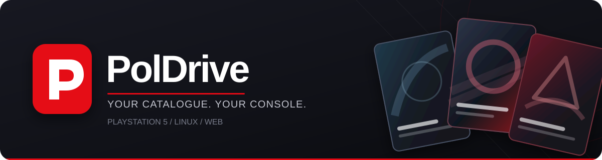

<div align="center">



**A console-first game catalogue, built for PlayStation 5, Linux and the web.**

Browse games and ROM listings in a TV-style interface with cover art, search, platform libraries and detailed game pages.


[What is PolDrive?](#what-is-poldrive) · [Features](#features) · [Get started](#get-started) · [Supported systems](#supported-systems) · [Documentation](#documentation)

</div>

> [!IMPORTANT]
> **PolDrive is currently a catalogue browser, not a working game installer.** It does **not** yet download packages, install PKGs, mount games or launch games. The PS5 LAN service serves the catalogue, not a remote download/install API.

## What is PolDrive?

**PolDrive** is an in-development, controller-friendly interface for exploring game and homebrew catalogue metadata. It presents games, ROM listings, artwork and available source/package information through a dark, console-inspired UI.

The project contains three related experiences:

- **PS5 browser payload** — a self-contained ELF that serves the web catalogue from the console and can register a PolDrive shortcut under **Home / Media** on supported Payload Manager setups.
- **Linux native app** — a C/SDL2 interface used as the visual and interaction reference.
- **Web app** — a React/TypeScript preview that runs in a desktop browser or from static hosting, including AI Studio.

The native app and browser use related catalogue data, but **do not yet have identical catalogue coverage or fully verified UI/input parity**.

## Features

| | Feature | What it does |
| :-- | :-- | :-- |
| 🎮 | **TV-style browsing** | Artwork-first Home screen, horizontal carousels and console-style navigation. |
| 🔎 | **Search and discovery** | Search loaded entries by name or title ID; browse games by console and category. |
| 🗂️ | **Platform libraries** | Explore PlayStation, Nintendo, Sega, Xbox and other console families. Availability depends on the catalogue source. |
| 🖼️ | **Artwork and screenshots** | Cover art with fallback handling, backdrops and screenshot panels where images are available. |
| 📋 | **Game details** | Descriptions, IDs, versions, source/package formats, related DLC and available metadata. |
| 🎛️ | **Filters and preferences** | Filter by catalogue source and package format; save language and filter preferences. |
| 🌐 | **Nine UI languages** | English, Polish, French, Dutch, German, Spanish, Italian, Simplified Chinese and Russian. |
| 🕹️ | **Multiple input methods** | Keyboard and mouse in the web preview; controller-oriented navigation in the native interface. Input parity is still being checked. |
| 📡 | **PS5 LAN access** | Browse the catalogue; pair with the code on the console to browse, edit and transfer PS5 files from a PC. |

**Not implemented yet:** actual package downloads, queues, installations, mounting, game launching, and remote control of these actions. The browser preview also does not import live catalogue entries when it checks the remote source manifest. See [remote-install-workflow.md](docs/remote-install-workflow.md) for the outstanding work.

## Get started

Choose how you want to run Poldrive.

### 1. Web preview (Windows, Linux or macOS)

The easiest way to explore the interface is in a browser.

**Requirements:** [Node.js](https://nodejs.org/) 20 or newer (22 recommended) and npm.

```bash
git clone https://github.com/PolDrive/PolDrive.git
cd PolDrive
npm ci
npm run dev
```

Open **http://localhost:3000**. The Vite development server uses port `3000` by default.

To create and serve the **standalone static preview** without keeping Vite or Node running:

```bash
npm run build:static
python3 -m http.server 3000 --directory static-preview
```

On Windows, use `python` instead of `python3`. Open **http://localhost:3000** again. The generated `static-preview/` folder can be hosted as ordinary static files at the URL root (including AI Studio). **Node is only needed to build it**; a *prebuilt* `static-preview/` can be served with any static HTTP server. Do not open the page using `file://`, because assets use root-relative paths.

### 2. Native Linux app

**Requirements:** GCC, Make, pkg-config, Python 3, SDL2, SDL2_ttf, SDL2_image and libcurl development libraries. Noto Sans CJK fonts are recommended for full multilingual character coverage.

On Debian/Ubuntu-based distributions, install the dependencies:

```bash
sudo apt update
sudo apt install build-essential pkg-config python3 \
  libsdl2-dev libsdl2-ttf-dev libsdl2-image-dev libcurl4-openssl-dev fonts-noto-cjk
```

Then, from the project root:

```bash
make build-linux
make linux
```

The executable is generated at `build/wolodrive`. Windows users can run this Linux build using **WSL/WSLg** with a suitable graphical environment; that is *not* a native Windows build.

### 3. PlayStation 5 (unified payload)

**Requirements:** a PS5 environment capable of loading homebrew ELFs, [PS5 Payload Manager](https://github.com/itsPLK/ps5-payload-manager), and a compatible loader. Building from source additionally requires the [PS5 Payload SDK](https://github.com/ps5-payload-dev/sdk) with the required dependencies.

With the SDK installed and `PS5_PAYLOAD_SDK` configured, build the unified payload:

```bash
make ps5
```

1. Copy the generated `build/poldrive.elf` to `/data/pldmgr/payloads/poldrive/poldrive.elf` on the console (both folder and filename are lowercase).
2. Launch **PolDrive** from Payload Manager. The payload attempts to register a **PolDrive** tile under **Home / Media**, then starts the native app with its file manager.
3. If native startup returns an error, the same ELF opens the embedded web fallback. On the console, **Files → Open folder** browses `/data`; **Parent folder** reaches `/` and accessible USB/system directories. On the PC, visit `http://<PS5-IP>:<port>/`, open **Files**. PCs on your trusted local network can edit UTF-8 text (1 MiB), download/upload/replace files (8 MiB), and use the shared copy/move/delete/unzip actions, subject to console permissions. Find the port in `/data/wolodrive-web.log` or `/data/wolodrive-web.endpoint` (8097 preferred). See [Files manager](docs/file-manager.md) for limits and device verification requirements.

Payload Manager's loopback service (port 8084) and an ELF loader must be available for the Home / Media shortcut to relaunch the app after each jailbreak. A previously compiled ELF can be used without building it yourself; this repository does **not** guarantee that a ready-to-install release is published.

Native PS5 SDL rendering remains **experimental**: earlier on-device testing hit a renderer startup failure, and combining the launchers does not fix that underlying issue. `make ps5-shortcut` now aliases `make ps5`; both produce `build/poldrive.elf`. `make ps5-web` produces only `build/wolodrive-web.elf` for browser diagnostics and never overwrites the unified payload. See the [PS5 build and setup notes](docs/ps5-build.md) for logs, verification and limitations.

## Supported systems

There is a difference between **devices that run PolDrive** and **consoles represented in its catalogue**.

### Where PolDrive runs

| Environment | Experience | Status |
| :-- | :-- | :-- |
| **PS5** (homebrew-capable) | Embedded LAN web catalogue via ELF, browser and Home / Media shortcut | Tested on a specific console/setup; firmware and loader compatibility vary |
| **Linux** | Native SDL2 app | Build path available; graphical behaviour depends on drivers and environment |
| **Windows** | Browser preview, or native Linux app via WSL/WSLg | Browser path available; native Windows executable not verified |
| **macOS** | Browser preview | Expected with a compatible modern browser; not separately verified |
| **Other devices on the PS5 LAN** | Web browser connecting to the PS5's HTTP service | Catalogue browsing; paired PC file editing/transfers require the console's access code |

### Consoles shown in the library

The library UI includes platform groupings such as **PS1, PS2, PS3, PS4, PS5, PSP; Xbox and Xbox 360; Nintendo NES through Switch and handhelds; Sega consoles; Atari; SNK; NEC; and select arcade and other systems**.

These are **catalogue categories, not a claim that PolDrive can emulate or run those systems**. Some console tiles have no connected catalogue data. Games and ROMs appear only when relevant source metadata is available; the Emulators section is not a bundled emulator.

## Controls

| Action | Keyboard / mouse | Native PS5-style controller |
| :-- | :-- | :-- |
| Move through the catalogue | Arrow keys / click | D-pad |
| Open a selected game | Enter / click | Cross |
| Go back / close a panel | Escape / Backspace | Circle |
| Change language | Language menu / `L` | Square |
| Refresh catalogue/source status | `R` or `F5` where supported | Triangle |

Controller input is part of the native UX; **the browser implements only a subset of the same controller interactions**. Keyboard and mouse are recommended for the standalone web preview.

## Development

The frontend uses **React 19, TypeScript and Vite**. The native implementation uses **C, SDL2 and libcurl**. The PS5 web ELF embeds the statically built browser UI, serves the catalogue over HTTP, and provides a filesystem bridge with paired LAN access. Ordinary static hosting, including AI Studio, remains independent of that bridge.

```bash
npm run lint              # TypeScript checks
npm run test:web          # Web UI and layout checks
npm run build:static      # Rebuild static-preview/
python3 tests/check_static_preview.py
make test-native-snapshot # Linux native catalogue test (SDL2 toolchain required)
```

Use `python` rather than `python3` on Windows. The full native test suite is `make test` on a configured Linux environment. A successful static build does not by itself validate AI Studio deployment or native PS5 behaviour.

## Documentation

- [PS5 build, ELF installation and LAN service](docs/ps5-build.md)
- [Planned download and remote installation workflow](docs/remote-install-workflow.md)
- [Catalogue source coverage](docs/source_index_coverage.md)
- [Artwork coverage](docs/artwork_coverage.md)
- [Full technical reference and original development notes](docs/technical-reference.md)

---

<div align="center">
  <sub>Built around a PS5-first experience · Catalogue browsing today, deeper console integration in progress.</sub>
</div>
